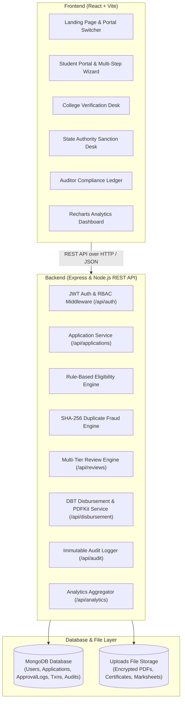
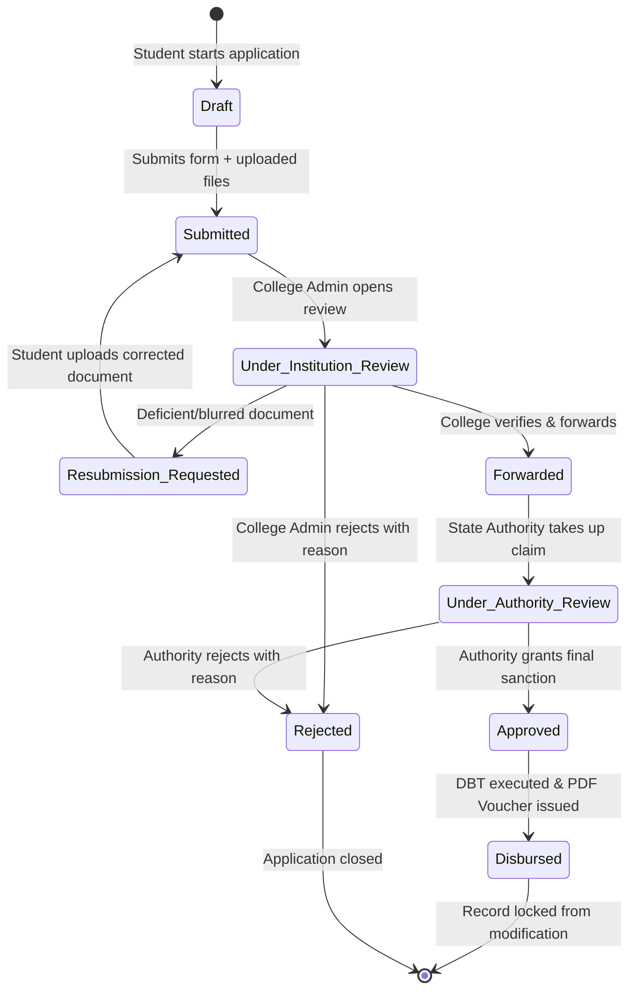

# FundEase — Paperless Scholarship Disbursement Platform (MERN Stack)

**FundEase** is an end-to-end, full-stack MERN (MongoDB, Express, React, Node.js) web application designed to digitize the complete lifecycle of scholarship applications, verification, multi-level approvals, and fund disbursement. It eliminates physical paperwork, eradicates processing bottlenecks, prevents duplicate claims, and provides full transparency through automated eligibility rules and an immutable compliance audit trail.

---

## Table of Contents
1. [Key Features & Capabilities](#key-features--capabilities)
2. [User Roles & Permissions](#user-roles--permissions)
3. [System Architecture](#system-architecture)
4. [Application Status Lifecycle State Machine](#application-status-lifecycle-state-machine)
5. [Automated Eligibility & Duplicate Fraud Detection Rules](#automated-eligibility--duplicate-fraud-detection-rules)
6. [Simulated Direct Benefit Transfer (DBT) & PDF Receipt Generation](#simulated-direct-benefit-transfer-dbt--pdf-receipt-generation)
7. [Pre-Seeded Demo Credentials](#pre-seeded-demo-credentials)
8. [Backend RESTful API Catalog](#backend-restful-api-catalog)
9. [Installation & Setup Guide](#installation--setup-guide)

---

## Key Features & Capabilities

- **100% Paperless Application Process**: Multi-step wizard with personal, academic, family income, and bank account credentials.
- **SHA-256 Document Fingerprinting**: Uploaded certificates (income certificates, marksheets, passbooks) are hashed via cryptographic SHA-256 upon ingest to detect forged or duplicate uploads across applicants.
- **Rule-Based Eligibility Engine**: Automatically computes an applicant qualification benchmark based on income ceilings and academic cutoffs.
- **Multi-Level Approval Chain**: Sequential verification flow: Student &rarr; Institution Admin (College) &rarr; State Scholarship Authority &rarr; Direct Benefit Transfer.
- **Simulated Direct Benefit Transfer (DBT)**: Real-time generation of transaction numbers, bank UTR reference codes, account masking (`XXXX-XXXX-1234`), and instant downloadable PDF vouchers created using `pdfkit`.
- **Immutable Compliance Audit Trail**: Non-modifiable audit collection recording every status transition, reviewer comment, and financial action for regulatory oversight by auditors.
- **Interactive Executive Analytics**: Real-time charts powered by `recharts` for tracking pipeline throughput, fund allocation by category, and fraud flags.
- **One-Click Role Switcher Bar**: Floating interactive bottom bar to switch roles between Student, College Desk, Authority Desk, and Auditor instantly without re-typing passwords.

---

## User Roles & Permissions

| Role | Access Scope & Capabilities |
| :--- | :--- |
| **Student** | Registers, fills 5-step application, uploads documents, tracks real-time progress via interactive timeline, resubmits revised documents if requested, downloads official PDF disbursement voucher. |
| **Institution Admin (College)** | Inspects student submissions from their college, reviews attached certificates in modal viewer, inspects automated duplicate/eligibility flags, verifies & forwards eligible claims, or rejects/requests resubmission with mandatory reason. |
| **Scholarship Authority (State/Trust)** | Final review of forwarded applications, sanctions eligible claims, triggers simulated DBT fund release, views settlement ledger with transaction UTR numbers. |
| **Auditor (Read-Only Compliance)** | Global inspection of all applications, immutable compliance log explorer (filter by role, action, severity, date), verifies audit trails for government/trust regulatory adherence. |

---

## System Architecture



---

## Application Status Lifecycle State Machine



---

## Automated Eligibility & Duplicate Fraud Detection Rules

When an application is submitted or reviewed, the system executes two automated verification algorithms:

### 1. Automated Eligibility Engine (`eligibilityService.js`)
- **Annual Family Income Check**:
  - General Category: Max ceiling ₹3,00,000/-
  - Reserved Categories (OBC, SC, ST, EWS): Max ceiling ₹5,00,000/-
- **Academic Merit Cutoff**:
  - Minimum CGPA cutoff: 6.0 / 10.0 (or minimum percentage &ge; 60.0%)
- **Document Completeness**:
  - Validates attachment of at least 3 verified certificates: Income Certificate, Academic Marksheet, and Bank Passbook / Cheque.
- Produces a composite **Eligibility Benchmark Score (0 - 100)** and itemized qualification notes.

### 2. Cross-Application Duplicate & Fraud Detection Engine (`fraudDetectionService.js`)
- **Aadhaar / National ID Duplicate Check**: Queries active applications to flag if an identical Aadhaar number was used across multiple claims.
- **Bank Account Duplicate Check**: Flags if the bank account number is already linked to another student's application.
- **SHA-256 File Hash Matching**: Every uploaded document has its SHA-256 cryptographic hash calculated upon arrival. If another student uploads the identical physical file, it triggers a **HIGH RISK** duplicate alert.
- Classifies risk as **LOW (Verified Clear)**, **MEDIUM (Review Advised)**, or **HIGH (Critical Duplicate Flag)**.

---

## Simulated Direct Benefit Transfer (DBT) & PDF Receipt Generation

Upon approval by the Scholarship Authority:
1. Generates a unique **Transaction Voucher Number** (e.g., `TXN-DBT-MTODBSNR-6691`).
2. Generates an authentic **Bank UTR (Unique Transaction Reference)** number (e.g., `UTR-SBIN-1788611871447-422`).
3. Masks the student's credit account for security (`XXXX-XXXX-4918`).
4. Uses `pdfkit` to compile an official, vector-drawn **Disbursement Electronic Voucher** complete with:
   - Government header and institutional emblem
   - Beneficiary credentials and college endorsement summary
   - Financial breakdown in numbers and words
   - Authority digital sign-off and verification key
5. Permanently locks the application (`isLocked: true`, `status: 'Disbursed'`) to prevent further tampering.

---

## Pre-Seeded Demo Credentials

All demo accounts share the password: `Password@123`

| Role | Name | Email | Password |
| :--- | :--- | :--- | :--- |
| **Student** | Aarav Sharma | `student@fundease.gov.in` | `Password@123` |
| **Student (Alternative)** | Priya Patel | `priya@fundease.gov.in` | `Password@123` |
| **College Desk (Admin)** | Dr. Vikram Seth | `admin@apexcollege.edu.in` | `Password@123` |
| **Authority Desk** | Meera Krishnan, IAS | `authority@scholarship.gov.in` | `Password@123` |
| **Auditor Desk** | Rajeshwar Rao | `auditor@compliance.gov.in` | `Password@123` |

> [!TIP]
> **One-Click Access**: You do not even need to type credentials manually! Simply use the floating **"Role Switcher"** toolbar at the bottom of the webpage to switch between all roles in one click.

---

## Backend RESTful API Catalog

### Authentication (`/api/auth`)
- `POST /api/auth/register` — Register new student or staff account
- `POST /api/auth/login` — Sign in and receive JWT token
- `GET /api/auth/me` — Retrieve active profile and unread notification count
- `GET /api/auth/notifications` — Fetch in-app notification alerts
- `PUT /api/auth/notifications/read` — Mark notifications as read

### Applications (`/api/applications`)
- `POST /api/applications/upload` — Upload documents via Multer & compute SHA-256 hash
- `POST /api/applications` — Submit new 5-step scholarship application
- `GET /api/applications/my` — Get logged-in student's applications
- `GET /api/applications` — Search & filter applications (Admin, Authority, Auditor)
- `GET /api/applications/:id` — Get full application detail with approval history
- `POST /api/applications/:id/resubmit` — Resubmit corrected documents

### Review Decisions (`/api/reviews`)
- `POST /api/reviews/institution/:id` — College review: `FORWARD`, `REJECT`, `REQUEST_RESUBMISSION`
- `POST /api/reviews/authority/:id` — Authority review: `APPROVE`, `REJECT`
- `GET /api/reviews/logs/:applicationId` — Get approval audit trail

### Disbursement & Vouchers (`/api/disbursement`)
- `POST /api/disbursement/:id` — Trigger simulated Direct Benefit Transfer & generate PDF
- `GET /api/disbursement/receipt/:applicationId` — Download official PDF voucher
- `GET /api/disbursement/transactions` — Get complete settlement ledger

### Compliance Audit & Analytics (`/api/audit`, `/api/analytics`)
- `GET /api/audit` — Immutable compliance audit trail (filtered by role, action, date)
- `GET /api/analytics/dashboard` — Aggregated metrics for Recharts charts

---

## Installation & Setup Guide

### Prerequisites
- **Node.js**: v18+ (tested on v22)
- **npm**: v9+ (tested on v10)
- **MongoDB**: Running locally on `mongodb://127.0.0.1:27017`

### 1. Clone & Install Dependencies
```bash
# Install root dependencies
npm install

# Install backend dependencies
cd server && npm install

# Install frontend dependencies
cd ../client && npm install
```

### 2. Seed Database with Realistic Data
Populate accounts for all 4 roles, realistic sample applications in every lifecycle state, uploaded documents, and audit logs:
```bash
npm run seed
```

### 3. Run Backend & Frontend Concurrently
From the project root:
```bash
npm run dev
```
- **Backend API**: `http://localhost:5000`
- **Frontend App**: `http://localhost:5173`
- **API Health Check**: `http://localhost:5000/api/health`

### 4. Run Automated Integration Test Suite
To verify the complete end-to-end workflow (Submission &rarr; Eligibility Evaluation &rarr; College Review &rarr; Authority Sanction &rarr; DBT Transfer &rarr; PDF Generation &rarr; Audit Trail):
```bash
cd server
node src/test-e2e.js
```
Expected output: `ALL END-TO-END WORKFLOW INTEGRATION TESTS PASSED (100%)`.
